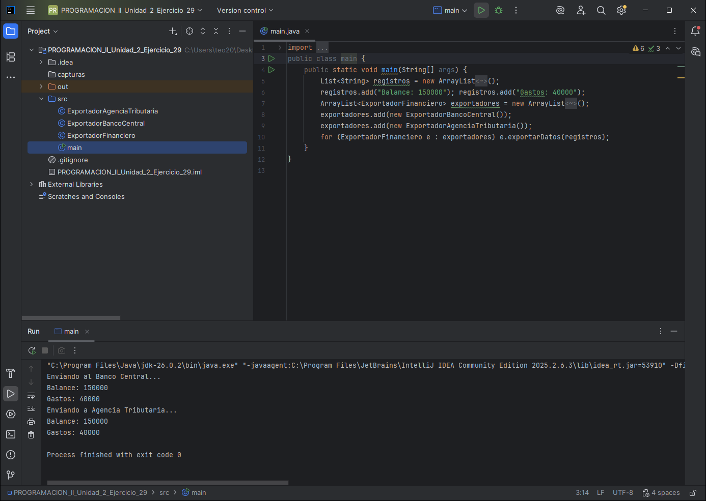

# PROGRAMACIÓN II — Unidad 2, Ejercicio 29: Automatización de Exportadores de Datos Financieros

Trabajo práctico de Programación II. Este repositorio contiene la resolución en Java del ejercicio 29 de la Unidad 2.

## Consigna

#### Contexto

Un módulo de contabilidad requiere exportar balances financieros hacia diferentes sistemas externos (bancos, agencias tributarias, hojas de cálculo locales). La modularidad del diseño permite añadir nuevos formatos de exportación en el futuro sin alterar la estructura del código existente.

#### Consigna

Implementar una arquitectura modular en Java utilizando clases abstractas para transformar y exportar estructuras de datos financieros.

#### Desarrollo requerido

- Crear una clase abstracta ExportadorFinanciero que contenga un método concreto de validación y un método abstracto void exportarDatos(List<String> registros).
- Implementar clases concretas como ExportadorBancoCentral y ExportadorAgenciaTributaria que sobrescriban el método de exportación.
- Añadir validaciones para asegurar que la lista de registros no esté vacía antes de iniciar el proceso.
- En el método main, instanciar los exportadores, invocar sus operaciones de forma polimórfica y mostrar por consola el progreso de la transferencia.

## Estructura del repositorio

```
PROGRAMACION_II_Unidad_2_Ejercicio_29/
├── README.md
├── capturas/
│   └── consola.png
└── src/
    ├── ExportadorAgenciaTributaria.java
    ├── ExportadorBancoCentral.java
    ├── ExportadorFinanciero.java
    └── main.java   # clase con el método main
```

## Funcionamiento y lógica

El ejercicio usa una **clase abstracta** con lógica compartida para exportar datos financieros a distintos organismos.

### `ExportadorFinanciero` (clase abstracta)

- **`validar(List<String> registros)`:** método común para todos los exportadores; verifica que la lista no sea `null` ni esté vacía y avisa si no hay registros.
- **`exportarDatos(List<String>)`:** método abstracto que cada exportador implementa.

### `ExportadorBancoCentral` y `ExportadorAgenciaTributaria`

Heredan de la clase abstracta. Al exportar, primero usan `validar()` y, si los datos son válidos, anuncian a qué organismo los envían e imprimen cada registro.

### `main`

Arma una lista con dos registros ("Balance: 150000" y "Gastos: 40000") y una lista de exportadores con uno de cada tipo. Al recorrerla, cada exportador envía los mismos datos a su organismo: primero al **Banco Central** y después a la **Agencia Tributaria**.

## Ejecución

Captura de la consola de IntelliJ IDEA ejecutando el programa:



Salida obtenida:

```
Enviando al Banco Central...
Balance: 150000
Gastos: 40000
Enviando a Agencia Tributaria...
Balance: 150000
Gastos: 40000
```
